# Predicting Heatwaves and Tropical Nights in Daegu

**Final report · KNU Big Data project (UrbanAtmos)**
**Authors:** Jeremi Wojciech Barciński, Tenzin Dorjee
**Date:** November 2026

This report explains the whole project, from downloading weather data to comparing two forecasting models.
It is written for **non-experts**: every formula, algorithm and data step comes with a plain-language
explanation of *what it is*, *how it works*, *why we used it* and *how it helps the task*.
The sections follow the presentation order, **Stage 1 to Stage 5**. Each stage ends with a
**key message** and **suggested slides**.

---

## Contents

- [Results at a glance](#results-at-a-glance)
- [The problem we solve](#the-problem-we-solve)
- [Stage 1: Data](#stage-1-data)
- [Stage 2: Cleaning the data](#stage-2-cleaning-the-data)
- [Stage 3: From hours to a daily table of clues and answers](#stage-3-from-hours-to-a-daily-table-of-clues-and-answers)
- [Stage 4: Modeling, persistence vs Random Forest](#stage-4-modeling-persistence-vs-random-forest)
- [Stage 5: Conclusions](#stage-5-conclusions)
- [How to reproduce](#how-to-reproduce)
- [Glossary](#glossary)

---

## Results at a glance

We predict **tomorrow** in Daegu from the weather of **today**, for three targets, and compare a simple rule
("tomorrow will be like today") with a machine-learning model (Random Forest).
Final scores on the **test summers 2025-2026**, which no model saw during development:

| Target (tomorrow) | Main score | Persistence (simple rule) | Random Forest | Winner |
|---|---|---|---|---|
| Max feels-like temperature | average miss (MAE), lower is better | 1.64 °C | **1.48 °C** | Random Forest, 10% smaller misses |
| Heatwave advisory day | F1 (0 to 1), higher is better | 0.806 | **0.812** | about equal (Random Forest slightly) |
| Tropical night | F1 (0 to 1), higher is better | 0.600 | **0.611** | about equal (Random Forest slightly) |

On the validation summers (2023-2024) the Random Forest won clearly on all three targets.
On the test summers it still won on every target, but its lead on the two yes/no targets was small.
Both models mostly fail in the same places: **the first day of a hot spell** (missed) and
**the day right after it ends** (false alarm).

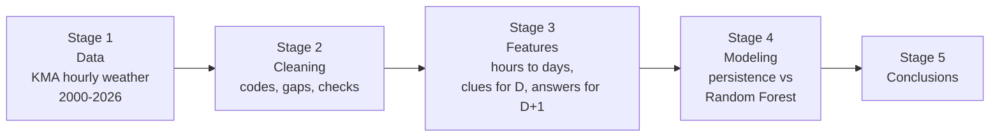

---

## The problem we solve

Daegu is one of the hottest cities in Korea. The Korea Meteorological Administration (KMA) issues
heat warnings based on the **feels-like temperature** (also called the perceived temperature),
which combines air temperature and humidity. We want to **predict, one day ahead**:

| What | Official rule (KMA) | Type of answer |
|---|---|---|
| **Heatwave advisory** | daily maximum feels-like temperature **≥ 33 °C for 2 or more days in a row** | yes / no |
| **Tropical night** | the lowest **air** temperature during the night (18:01-09:00) **≥ 25 °C** | yes / no |
| **Max feels-like temperature** | the day's highest feels-like temperature | a number in °C |

KMA also has stronger levels: the **alarm** (≥ 35 °C for 2 days) and the **major alert** (≥ 35 °C for 3 days).
We dropped them because they are too rare to learn from (see Stage 3).

> **Explained: yes/no prediction vs number prediction**
> - **What:** a *classification* task answers yes or no (will there be a tropical night?).
>   A *regression* task predicts a number (how hot will it feel?).
> - **Why it matters:** the two kinds of task are scored differently. A yes/no answer is either right or wrong.
>   A number can be "close" (off by 0.5 °C) or "far" (off by 4 °C). Stage 4 uses different scores for each.

---

## Stage 1: Data

### What data we used

Our data is the **ASOS** dataset (Automated Synoptic Observing System) from the KMA:
official hourly measurements from **weather station 143 in Daegu**. These are the same measurements
KMA uses for its own records and warnings.

> **Explained: weather station data and an API**
> - **What:** a weather station is a set of instruments (thermometer, hygrometer for humidity, barometer
>   for pressure, wind vane, rain gauge, sunshine and radiation sensors) that records the weather every hour.
>   An **API** (Application Programming Interface) is a web address that a program can ask for data,
>   instead of a person downloading files by hand.
> - **How we used it:** our script `A_ASOS_01_fetch_daegu_asos.py` asks the KMA API Hub for one month at a time.
>   It saves every month as a raw file, so the download can stop and continue (the API allows 2,000 requests per day).
>   At the end it merges all months into one table.
> - **Why:** about 27 years of hourly data is 234,600 rows. Downloading it automatically is the only practical
>   way, and it makes the work repeatable.

**Raw result:** `ASOS_01_Daegu_asos_hourly.csv`, with 234,600 hours from 2000-01-01 to 2026-10-05
and 46 fields per hour (44 measurements plus time and station number).

### A second dataset we explored: ERA5 (Open-Meteo)

Before ASOS we downloaded **ERA5** data through the Open-Meteo service.

> **Explained: reanalysis data (ERA5)**
> - **What:** ERA5 is not measured at one place. A computer weather model combines millions of observations
>   (satellites, stations, balloons) and produces a complete, gap-free estimate of the weather on a grid
>   covering the whole world.
> - **Pros and cons:** it never has missing values and includes extra variables (air pollution). But it is an
>   *estimate* for a grid cell around Daegu, not the official measurement at the station.

| Compare | ASOS (KMA) | ERA5 (Open-Meteo) |
|---|---|---|
| Where the data comes from | measured by station 143 in Daegu | estimated by a computer model (reanalysis) |
| Variables available | 46 fields per hour (44 measurements) | 16 requested: 10 weather + 6 air quality |
| Variables we kept | 15 read, 12 after cleaning | 16 |
| Years available | 2000-01-01 to 2026-10-05 | weather from 2020-01-01, air quality from 2022-08-04 |
| Years we kept | from 2014 (the station moved in September 2013) | from 2023 in the cleaned file |
| Continuous variables (any value, e.g. 27.4 °C) | 11 | 16 |
| Discrete variables (fixed categories) | 1 (wind direction: 36 directions or calm) | 0 |
| Used for modeling? | **yes** | no (not ready, see Stage 5) |

**Why ASOS:** it is the official measurement behind KMA's heat warnings, and it covers
**13 summers** (2014-2026), compared with 4 for ERA5. More summers means more heatwaves to learn from.

### Why we start in 2014

Station 143 **moved to a new location in September 2013**. A thermometer in a new place
(different surroundings, height or surface) reads slightly differently. Mixing old and new readings would
create an artificial jump in the data that looks like climate change but is not. So we only use 2014 onwards.

### The 12 variables we kept

| Variable | Meaning in plain words | Unit |
|---|---|---|
| `temperature` | air temperature | °C |
| `dew_point` | the temperature at which the air would become saturated; higher means more moisture in the air | °C |
| `relative_humidity` | how full of water vapour the air is, compared with the maximum it can hold | % |
| `vapor_pressure` | the pressure made by the water vapour alone (another moisture measure) | hPa |
| `station_pressure` | air pressure at the station | hPa |
| `sea_level_pressure` | air pressure converted to sea level, so stations at different heights can be compared | hPa |
| `wind_speed` | how fast the wind blows | m/s |
| `wind_direction_code` | where the wind comes **from** (36 directions × 10°, 0 = calm) | code |
| `sunshine_hours` | the part of the hour with direct sunshine | 0-1 hour |
| `solar_radiation_mj` | the sun's energy reaching the ground | MJ/m² |
| `ground_temperature` | temperature at the ground surface | °C |
| `precipitation` | rain (or melted snow) | mm |

> **Key message, Stage 1:** we use 13 summers of official hourly measurements from the KMA station in Daegu.
> We start in 2014 because the station moved in 2013.
>
> **Suggested slides:** (1) the problem and the KMA rules; (2) ASOS vs ERA5 comparison table;
> (3) the 12 variables.

---

## Stage 2: Cleaning the data

Raw data always has problems: missing hours, special codes, broken sensors. Cleaning makes sure the model
learns from **real weather**, not from errors. Script: `A_ASOS_02_clean_asos.py`.
A report of every step is saved in `ASOS_02_Daegu_asos_clean_report.txt`.

### Step 1: A complete hourly timeline

We sorted the data by time and removed duplicate hours (there were none). Then we built a complete hourly
timeline: every hour from the first to the last must exist exactly once. **Result:** 0 hours were missing
from the timeline itself.

### Step 2: Turning KMA's "no data" codes into real gaps

KMA does not leave a cell empty when a sensor fails. It writes a **code**: `-9` or `-99`.
If we kept these numbers, the model would believe the air pressure was -9 hPa.

> **Explained: NaN (missing value)**
> - **What:** NaN means "Not a Number". It is how a computer marks "we don't know this value".
> - **Why:** a missing value must look missing. A fake number like -9 would be treated as a real measurement
>   and would distort averages and models.

**The tricky case: -9.0 °C can be real.** In winter, Daegu can really be -9.0 °C. So for temperature-like
columns (air, dew point and ground temperature), our script decides whether -9.0 is a code or a real value:

1. **Summer rule:** -9.0 °C in May-September is impossible, so it is a code.
2. **Neighbour rule:** look at the closest valid readings within 6 hours before and after.
   If their average is close to -9 (within 4 °C for air temperature, 6 °C for dew point and ground),
   then -9.0 is believable. Otherwise it is a code.

*Example:* at 03:00 the reading is -9.0, and the neighbours are -8.2 and -9.6 (average -8.9). That is
believable, so it is a real value. If the neighbours were +12 and +13, then -9.0 is an obvious code.

**Results:** all 24 air temperature readings of -9.0 were real winter values.
For ground temperature, 56,889 of 58,570 readings of -9.0 were codes, and 1,681 were real.

### Step 3: Sun data at night

Solar radiation and sunshine sensors often report a code at night. But at night the true value is simply **0**.

> **Explained: solar elevation**
> - **What:** the angle of the sun above the horizon. Below 0° means the sun has set.
> - **How:** a standard astronomy formula (the NOAA approximation) calculates this angle from the date,
>   the hour and the station's latitude and longitude.
> - **Why:** it lets us tell night from day. A code at night becomes 0 (correct: no sun).
>   A code during the day becomes NaN (we really don't know).

**Results:** 105,912 night-time codes became 0. Only 284 daytime values stayed missing.

### Step 4: Rain codes

KMA marks "no rain" with a flag (`IR = 3`) instead of writing 0 mm. We turned these into **0 mm**
(138,848 hours). Real gaps stayed NaN.

### Step 5: Physical range checks

Every value was checked against physically possible limits, for example air temperature between -40 and 50 °C
and humidity between 0 and 100%. **Result:** no impossible values were found.

### Step 6: Missing-data report, per column and per year

We counted the missing values per column and per year. Two columns had large gaps exactly in our period:

| Column | Missing in 2014 | 2015 | 2016-2017 | 2018 |
|---|---|---|---|---|
| `cloud_cover_tenths` | 100% | 57% | about 22% | 13% |
| `visibility_10m` | 100% | 35% | 0% | 0% |

These gaps are **structural**: whole years are missing, not single hours. So in a separate small script
(`A_ASOS_02_clean_asos_after_report.py`) we **dropped both columns** instead of inventing values for them.
That left **12 variables**.

### Step 7: Filling short gaps with linear interpolation

> **Explained: linear interpolation**
> - **What:** filling a missing value by drawing a straight line between the known values before and after it.
> - **Formula** (for a missing point at time $x$, between the known points $(x_0, y_0)$ and $(x_1, y_1)$):
>
> ```math
> y = y_0 + \frac{y_1 - y_0}{x_1 - x_0} \cdot (x - x_0)
> ```
>
> - **Example:** 14:00 is 25.0 °C, 17:00 is 28.0 °C, and 15:00 and 16:00 are missing.
>   The temperature rises 3 °C over 3 hours, so 1 °C per hour: 15:00 = 26.0 °C and 16:00 = 27.0 °C.
> - **Why only gaps of 3 hours or less, and only smooth variables:** temperature, humidity and pressure change
>   smoothly from hour to hour, so a straight line over 1-3 hours is a very good guess.
>   Over longer gaps (a front passing, a sudden storm) the guess becomes invention. Rain and sunshine change
>   suddenly, so they are **never** interpolated.
> - **How it helps:** later, a daily maximum needs most hours of the day. Filling a 1-hour hole keeps the
>   whole day usable.

(Before 2008, dew point and pressure were recorded only every 3 hours. Interpolation filled most of those
hours, but those years are cut in the next step anyway.)

### Step 8: Cut to the analysis period

We kept 2014-01-01 onwards: **111,864 hours**.

### Step 9: Extreme values and stuck sensors (report only)

> **Explained: percentile**
> - **What:** the 99.9th percentile is the value that only 0.1% of all readings are above.
> - **Why:** it is a simple way to list the most extreme readings for a human to check.

The highest air temperature was **39.5 °C on 2026-08-03 at 15:00**. It is extreme but **real** (a record heat
event). We **removed nothing**: extreme heat is exactly what we want to predict, and deleting it would teach the
model that such days do not exist.
We also looked for **stuck sensors** (the same value 12 or more hours in a row) and found none.

**Result of Stage 2:** `ASOS_022_Daegu_after_report_clean.csv`, with 111,864 hours × 12 clean variables.

> **Key message, Stage 2:** we turned KMA codes into real gaps, used astronomy to fix night-time sun data,
> filled only short gaps in smooth variables, dropped two incomplete columns, and kept every real extreme.
>
> **Suggested slides:** (1) the -9.0 puzzle (summer rule + neighbour rule); (2) linear interpolation with
> the 25 → 28 °C example; (3) the missing-data table and the decision to drop cloud cover and visibility.

---

## Stage 3: From hours to a daily table of clues and answers

KMA's rules are about **days** (daily maximum, night minimum, days in a row), so the model must work with days.
Script: `A_ASOS_03_make_features.py`.

> **Explained: features and targets**
> - **Features** are the *clues* the model may use: everything known by **23:00 on day D**.
> - **Targets** are the *answers* it must learn to predict: what happens on **day D+1** (tomorrow).
> - **Each row** of the final table = one summer day D, with its clues and tomorrow's answers.
>   The model studies thousands of such rows and learns how clues lead to answers.

### Step 1: Feels-like temperature, every hour

KMA's summer feels-like formula (in use since 2022-06-02) has two parts.

> **Explained: wet-bulb temperature**
> - **What:** imagine a thermometer wrapped in a **wet cloth**. Water evaporates from the cloth and cools it,
>   the same way sweat cools your skin. In dry air a lot evaporates, so it reads much lower than the air.
>   In humid air little evaporates, so it reads almost the same as the air.
> - **Why it matters:** it measures how well the body can cool itself by sweating. A high wet-bulb temperature
>   means sweating stops working, which is why humid heat is dangerous.
> - **How we compute it** (Stull's formula, with $T$ = air temperature in °C and $RH$ = relative humidity in %):
>
> ```math
> T_w = T\cdot\arctan\!\big(0.151977\sqrt{RH+8.313659}\big) + \arctan(T+RH) - \arctan(RH-1.67633) + 0.00391838\,RH^{1.5}\arctan(0.023101\,RH) - 4.686035
> ```
>
>   The station does not measure wet-bulb temperature, so this formula **converts** temperature and humidity
>   into it. Meteorologist Roland Stull found it by fitting a curve to laboratory measurements.
>   It is a recipe to apply, not something to derive (`arctan` is just a smooth S-shaped curve used in the fit).

> **Explained: KMA feels-like formula**
>
> ```math
> \text{FeelsLike} = -0.2442 + 0.55399\,T_w + 0.45535\,T - 0.0022\,T_w^2 + 0.00278\,T_w\,T + 3.0
> ```
>
> - **In plain words:** about **55% wet-bulb + 46% air temperature + 3 °C**. The two small terms fine-tune the result.
> - **Example** at 33 °C air temperature: 40% humidity gives 31.4 °C (no advisory level), 70% gives 34.3 °C
>   (advisory level), and 90% gives 36.0 °C (alarm level). **Same air temperature, three different warnings.**
> - **Why we used it:** the heatwave rules are written in feels-like temperature, so our answers (targets)
>   must be calculated with KMA's own formula.

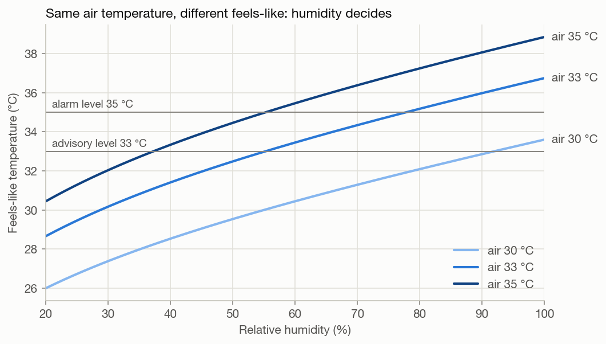

*How to read it:* each line is one air temperature. Moving right (more humid air), the feels-like temperature
rises. A 33 °C day crosses the advisory line at about 55% humidity, and the alarm line at about 78%.
Over our data, feels-like is on average 0.8 °C above the air temperature, and at most 3.5 °C above.

### Step 2: Wind as arrows (u and v)

> **Explained: why wind direction needs sine and cosine**
> - **The problem:** direction is a circle. 350° and 10° are both almost north, but as numbers they look far apart.
>   Their average, 180°, points **south**, exactly wrong.
> - **The fix:** turn each wind into an **arrow** with an east-west part ($u$) and a north-south part ($v$),
>   where $s$ is the wind speed and $\theta$ the direction in degrees:
>
> ```math
> u = -s \cdot \sin(\theta), \qquad v = -s \cdot \cos(\theta)
> ```
>
>   The minus signs are there because KMA records where the wind comes **from**, while the arrow points where
>   the air **goes**. Example: a 3 m/s wind from the north (θ = 360°) gives u = 0, v = -3, meaning air moving south.
> - **Why:** arrows can be averaged safely, so a daily average wind makes sense. Calm hours become (0, 0).

### Step 3: Hours to days (daily summaries)

For each day, the 24 hourly values are summarised as **minimum, maximum, mean or sum**:
for example `feels_like_max` (the hottest-feeling hour), `relative_humidity_mean`, `precipitation_sum` and
`temperature_range` (max - min). This gives 26 daily columns.

**Safety rule:** a daily value is computed only if **at least 20 of the 24 hours** are valid.
A "daily maximum" built from 5 hours could easily miss the real peak.
**Result:** 111,864 hours became 4,661 days.

### Step 4: The night window

A tropical night crosses midnight, so we define the **night of day D** as:

```
Day D 19:00 ─────────── midnight ─────────── Day D+1 09:00
          15 hourly readings, all counted as "the night of D"
```

`night_min_air` is the lowest air temperature in this window. It is used only if at least 12 of the 15 hours are valid.
*Coding trick:* shifting every timestamp back by 10 hours puts 19:00 D to 09:00 D+1 on the same calendar date D.

### Step 5: The answers (targets)

| Target | Rule (for one day) |
|---|---|
| `tmax_feels` | the day's maximum feels-like temperature |
| `tropical_night` | 1 if `night_min_air` ≥ 25 °C, otherwise 0 |
| `heatwave_advisory` | 1 if the day belongs to a **run of 2 or more days in a row** with feels-like maximum ≥ 33 °C |

> **Explained: runs of days in a row**
> - **How:** a "run" is a block of hot days in a row. A cooler day breaks it.
>   Every day in a run gets the length of the **whole** run.
>
> | Day | Mon | Tue | Wed | Thu | Fri | Sat |
> |---|---|---|---|---|---|---|
> | Feels-like max | 34 | 31 | 34 | 35 | 33 | 30 |
> | ≥ 33? | yes | no | yes | yes | yes | no |
> | Run length | 1 | - | 3 | 3 | 3 | - |
> | Advisory | 0 | 0 | 1 | 1 | 1 | 0 |
>
> - Monday is hot but **alone**, so there is no advisory. Wednesday to Friday is a run of 3, so all three get 1
>   (33 counts, because the rule is "33 or more").
> - Targets are computed on the full year before cutting to summer, so a run at the edge of the season is not cut in half.

### Step 6: The clues (features)

**The golden rule: use only what is known by 23:00 on day D.** Using future information by accident is called
**data leakage**. It is the most dangerous bug in forecasting: the model looks brilliant in testing and fails
in real life.

| Clue type | What it is | Example |
|---|---|---|
| Today's weather (26) | the daily summaries from Step 3 | `feels_like_max`, `dew_point_min` |
| **Lags** (20) | the value from k days ago | `feels_like_max_lag1` = yesterday's maximum |
| **Rolling means** (6) | the average of the last 3 or 7 days, ending today | `feels_like_max_roll3` |
| **Pressure change** (2) | today minus yesterday, or minus 3 days ago | `station_pressure_diff1` |
| **Streaks** (2) | hot days in a row up to today | `hot33_streak` (feels-like ≥ 33), `hot35_streak` |
| **Last night** (1) | minimum of the most recent *complete* night | `night_min_air_prev` |
| **Season** (2) | the day of the year as a point on a circle | `doy_sin`, `doy_cos` |

That is **59 clues** in total.

> **Explained: lag, rolling mean and difference**
> - **Lag:** $x_{\text{lag}k}(D) = x(D-k)$. Example: `feels_like_max_lag1` on 12 July = the maximum on 11 July.
> - **Rolling mean:** $x_{\text{roll}3}(D) = \frac{x(D) + x(D-1) + x(D-2)}{3}$. It smooths out single odd days
>   and shows the trend. It needs at least 2 valid days of 3 (or 5 of 7).
> - **Difference:** $\Delta p(D) = p(D) - p(D-1)$. Falling pressure often signals a change in the weather (rain, a front).
> - **Why:** weather has **memory**. A heatwave builds up over days, so recent days carry strong clues about tomorrow.

> **Explained: day of the year as a circle (sine and cosine)**
>
> ```math
> \text{doy\_sin} = \sin\!\left(\frac{2\pi \cdot \text{day}}{365.25}\right), \qquad \text{doy\_cos} = \cos\!\left(\frac{2\pi \cdot \text{day}}{365.25}\right)
> ```
>
> - **Why:** as plain numbers, 31 December (day 365) and 1 January (day 1) look far apart, but they are neighbours.
>   Placing each day on a circle, like a clock face, keeps neighbouring days close. ($2\pi$ just means one full turn.)
> - **How it helps:** the model learns the season ("mid-August is the hottest time") without being confused at the year boundary.

**Why the "previous" night?** The night that starts on the evening of day D ends at 09:00 on D+1,
which is not known at 23:00 on D. So the newest complete night is the one that ended on the morning of D.

### Step 7: Line up today's clues with tomorrow's answers, keep summers, split by years

Each row's answers are moved up by one day, so **row D holds the answers of day D+1** (renamed with `y_`:
`y_tmax_feels`, `y_tropical_night`, `y_heatwave_advisory`). A real example from July 2018:

| Date D | Feels-like max today | `hot33_streak` | Yesterday's max | 3-day mean | Last night's min | **Advisory tomorrow?** | **Tropical night tomorrow?** | **Max tomorrow** |
|---|---|---|---|---|---|---|---|---|
| 07-10 | 30.2 | 0 | 22.6 | 25.1 | 18.6 | 0 | 0 | 32.1 |
| 07-11 | 32.1 | 0 | 30.2 | 28.3 | 23.2 | 0 | 1 | 32.8 |
| 07-12 | 32.8 | 0 | 32.1 | 31.7 | 24.9 | **1** | 1 | 33.6 |
| 07-13 | 33.6 | 1 | 32.8 | 32.8 | 26.7 | 1 | 1 | 33.5 |
| 07-14 | 33.5 | 2 | 33.6 | 33.3 | 26.5 | 1 | 1 | 33.5 |

How to read the 07-12 row: today (32.8) is not yet hot enough, but **tomorrow** (07-13, 33.6) starts a hot run,
so the answer is 1. The model's job on 07-12 is to notice the warning signs: rising temperatures and a high
3-day mean. Notice that "Max tomorrow" in one row equals "Feels-like max today" in the next row. That is the one-day shift.

**Keep only summers:** both D and D+1 must be in May-September, which leaves **1,976 days** (13 summers × 152 days).
All event days fall in June-September.

> **Explained: train / validation / test split**
> - **What:** the days are divided into three groups **by year**:
>
> | Split | Years | Days | School analogy |
> |---|---|---|---|
> | **train** | 2014-2022 | 1,368 | the textbook the model studies from |
> | **val** (validation) | 2023-2024 | 304 | practice exams, used to fine-tune settings |
> | **test** | 2025-2026 | 304 | the final exam, taken **once** |
>
> - **Why by years and not randomly:** neighbouring days are almost identical (a heatwave lasts several days).
>   If 13 July were in train and 14 July in test, the model would have practically seen the answer.
>   Splitting by years forces it to predict summers it has never seen, just like in real life.

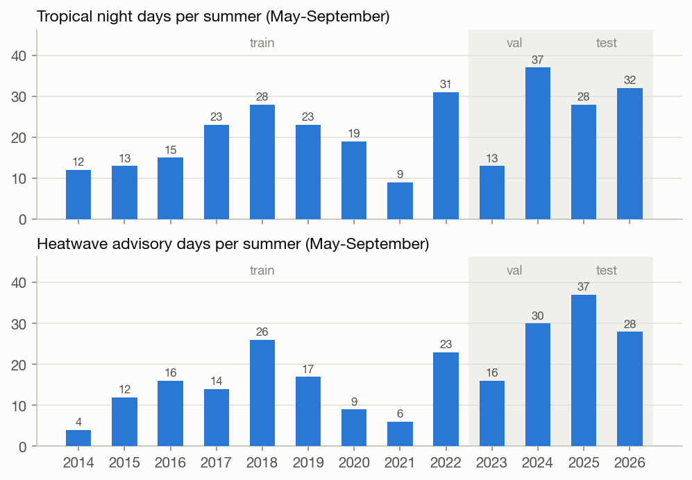

*How to read it:* each bar is one summer. Recent summers are hotter: tropical nights rose from 12 (2014) to 37 (2024),
and advisory days from 4 (2014) to 37 (2025). So the test years contain **more event days** than the training years
(see the table below). This makes the final exam harder, and it is why we always report the share of event days next to every score.

| Share of event days (%) | train | val | test |
|---|---|---|---|
| Tropical night tomorrow | 12.6 | 16.4 | 19.7 |
| Advisory tomorrow | 9.3 | 15.1 | 21.4 |

### Step 8 (after the report): drop the alarm targets

The Stage 3 report showed that the alarm levels (≥ 35 °C) are far too rare: **6 alarm days and 0 extended-alarm days**
in all 9 training summers. A model cannot learn a pattern it has seen 6 times or never, so a small script
(`A_ASOS_03_make_features_after_report.py`) dropped them.

**Result of Stage 3:** `ASOS_03_Daegu_daily_features_after_report.csv`, with 1,976 days × 59 clues + 3 answers.

> **Key message, Stage 3:** we calculated KMA's feels-like temperature from temperature and humidity, summarised
> hours into days and nights, built 59 clues using only past information, and lined each day up with tomorrow's answers.
> The data is split by years so the final test is honest.
>
> **Suggested slides:** (1) feels-like formula + humidity figure; (2) the night window and the runs-of-days table;
> (3) clues vs answers with the July 2018 example; (4) the split and the event-days-per-year figure.

---

## Stage 4: Modeling, persistence vs Random Forest

Script: `A_ASOS_04_modeling.py`. We compare **one simple baseline** and **one machine-learning model**
on the three targets.

### Why a baseline first?

> **Explained: baseline**
> - **What:** the simplest reasonable way to make a prediction, with no learning at all.
> - **Why:** a score like "F1 = 0.61" means nothing on its own. It only becomes meaningful when compared with
>   something simple. If a complex model cannot beat a one-line rule, it has not learned anything useful.

### The baseline: persistence ("tomorrow will be like today")

Weather changes slowly, so "tomorrow will be like today" is a surprisingly strong forecast. It is the standard
first baseline in meteorology. Its rules are fixed in advance, using KMA's own thresholds:

| Target | Persistence rule |
|---|---|
| Max feels-like tomorrow | = today's max feels-like temperature |
| Advisory tomorrow | yes if today's max feels-like ≥ 33 °C |
| Tropical night tomorrow | yes if the last complete night (D-1 → D) had a minimum ≥ 25 °C |

(For the tropical night, the target night starts on the evening of D+1, while the newest complete night ended on
the morning of D. So persistence copies a night that is **two nights** earlier, which makes this target harder for it.)

### The model: Random Forest

#### Part A: one decision tree

> **Explained: decision tree**
> - **What:** a flowchart of yes/no questions, like the game "20 Questions". Here is a made-up example for "tropical night tomorrow?":

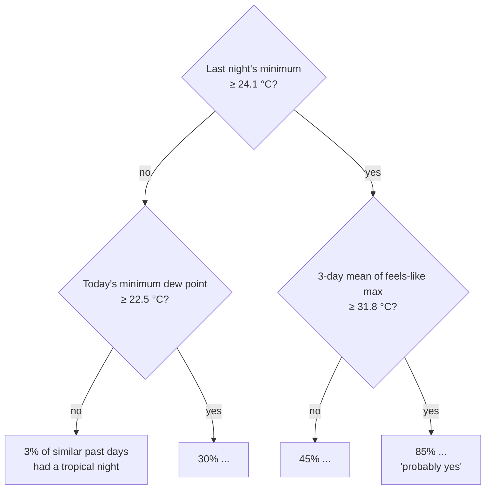

> - **How it chooses its questions:** it tries every clue and every cut-off value. It keeps the question that best
>   **separates** yes-days from no-days, so each side is as "pure" as possible. Purity is measured with the **Gini impurity**
>   ($p$ = share of yes-days in a group):
>
> ```math
> G = 1 - \left(p_{\text{yes}}^2 + p_{\text{no}}^2\right)
> ```
>
>   G = 0 means a pure group (all yes or all no). G = 0.5 is the worst possible (half and half).
>   The tree picks the cut-off with the lowest **weighted average** G of the two sides, then repeats on each side.
> - **What the end boxes ("leaves") store:** for yes/no targets, the **share of yes-days**, which is the
>   **probability** (e.g. 0.85). For the temperature target, the **average temperature of tomorrow** for the
>   training days in that box.
> - **The weakness:** a deep tree can memorise its training days ("on 14 July 2018 at exactly 26.7 °C it was yes").
>   This is called **overfitting**: perfect on old data, poor on new data. A single tree is also unstable:
>   change a few days and you get a very different tree.

**A tiny worked example** (8 made-up training days, the clue "last night's minimum"):

| Last night's minimum (sorted) | 21.0 | 22.5 | 23.0 | 24.5 | 25.2 | 25.2 | 25.6 | 26.0 |
|---|---|---|---|---|---|---|---|---|
| Tropical night tomorrow? | 0 | 0 | 0 | 0 | 1 | 1 | 0 | 1 |

| Cut-off tried | Left group | Right group | Weighted Gini |
|---|---|---|---|
| 23.75 | 0,0,0 → G = 0 | 0,1,1,0,1 (3 of 5 yes) → G = 0.48 | 5/8 × 0.48 = 0.30 |
| **24.85** | 0,0,0,0 → G = 0 | 1,1,0,1 (3 of 4 yes) → G = 0.375 | **4/8 × 0.375 = 0.19** ← best |

The tree asks "last night ≥ 24.85 °C?". The YES box gets probability 3/4 = 0.75 and the NO box gets 0/4 = 0.
(Cut-offs are midpoints between neighbouring values: (24.5 + 25.2) / 2 = 24.85.)

#### Part B: a forest of many different trees

> **Explained: Random Forest**
> - **What:** a crowd of **500 decision trees** whose answers are **averaged**.
> - **How each tree is made different on purpose:**
>   1. **Bootstrap sample:** each tree learns from a random draw of training days *with replacement*
>      (some days appear twice, some not at all).
>   2. **Random clues:** at each question, a tree may only choose from a random handful of the clues
>      (about 8 of 59). Otherwise every tree would start with the same strongest clue and they would all look alike.
> - **Final answer:** the average of all trees. For yes/no targets this is a probability (if 400 of 500 trees
>   lean "yes", the probability is about 0.8). For temperature it is an average temperature.
> - **Analogy:** ask one person and you get their personal quirks. Ask 500 people who each studied slightly
>   different old records, and their individual mistakes cancel out while the shared, real pattern remains.

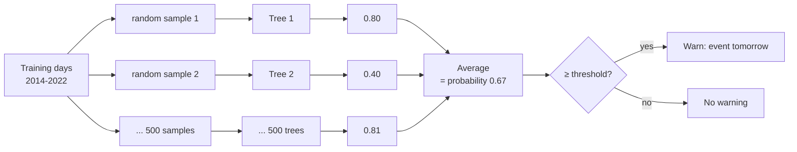

**Why Random Forest suits this project:**

1. **Our targets are threshold rules ("≥ 33", "≥ 25"), and trees think in thresholds.**
2. **It catches combinations:** "hot **and** humid" gives a tropical night, "hot and dry" does not.
3. **It needs no rescaling** of the clues (pressure around 1,000 hPa and rain around 0-50 mm can be mixed freely).
4. **It handles the few missing values** directly (scikit-learn ≥ 1.4).
5. **It is robust to extreme values:** a tree only asks "above or below?", so one extreme reading cannot bend the model.
6. **It works well with default settings** and has few settings to tune.
7. **It is explainable:** "500 flowcharts that vote", plus a ranking of which clues matter.

**Its honest weaknesses:**

- It **cannot predict beyond what it has seen**: a leaf can only average past values. In the test summers the
  hottest real day felt like 36.3 °C, but the forest's highest prediction was 34.8 °C.
- Its probabilities are slightly "squashed" towards the middle (they rarely reach 0 or 1). That is fine, because
  we choose our own decision threshold (see below).

### How the two models use the three splits

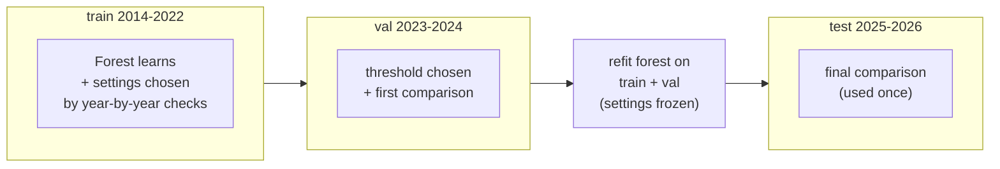

| Split | Persistence | Random Forest |
|---|---|---|
| **train** | nothing to learn | learns; settings chosen by year-by-year checks inside train |
| **val** | rules applied, scored | predicts with probabilities; **threshold chosen here**; first comparison |
| **train + val** | - | retrained with the frozen settings and threshold (more recent, hotter years) |
| **test** | rules applied, scored **once** | predicts, scored **once**; nothing changed afterwards |

### Choosing the settings: year-by-year checks inside train

> **Explained: expanding-window validation**
> - **What:** a series of mini practice exams inside the training years, always predicting a *later* year than
>   the ones studied:
>
> ```
> study 2014-2016            → quiz on 2017
> study 2014-2017            → quiz on 2018
>   ...
> study 2014-2021            → quiz on 2022
> ```
>
> - **Why:** it imitates real forecasting (the past predicts the future) and uses 6 quizzes instead of 1,
>   so the choice is more reliable. Val and test are not touched.
> - **What was tried:** the minimum number of days allowed in a leaf (5, 10, 20; bigger means smoother and less
>   memorising), and **class weight** (none, or "balanced" = make rare yes-days count more).
>   For temperature: leaf size, and whether each question may look at about 8 clues or all 59.

| Target | Chosen settings |
|---|---|
| Tropical night | leaf ≥ 20 days, no class weight |
| Heatwave advisory | leaf ≥ 5 days, no class weight |
| Max feels-like | leaf ≥ 5 days, each question may look at all 59 clues |

"Balanced" class weights were tried but scored lower in the year-by-year checks, so they were not used.

### Turning a probability into yes/no: the decision threshold

> **Explained: decision threshold**
> - **What:** the forest gives a probability, like 0.42. A warning needs yes or no. The threshold is the cut-off:
>   "say yes if the probability ≥ threshold".
> - **Why not just 0.5?** For rare events, 0.5 is usually too strict or too loose. A lower threshold catches more
>   events but raises more false alarms; a higher one does the opposite.
> - **How we chose it:** on **val**, we tried every threshold from 0.05 to 0.95 and kept the one with the
>   **best F1** (explained below). On a tie, the lower threshold wins, because more warnings is the safer side.
>   Result: **0.55** for tropical night, **0.31** for advisory. Both were then frozen for the test.

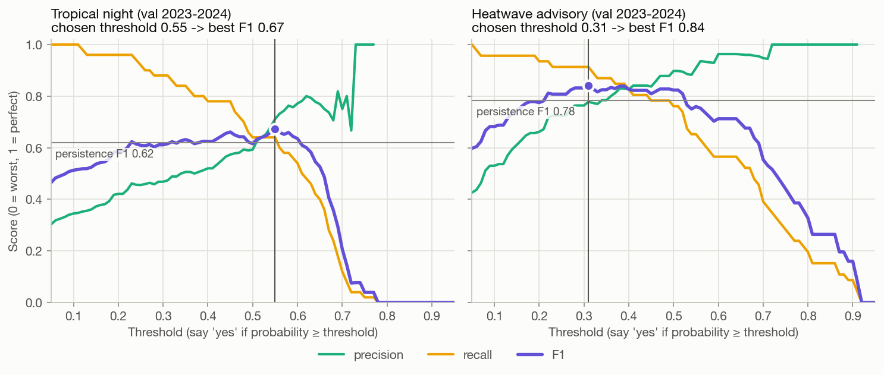

*How to read it:* moving the threshold right makes the forest more cautious. Precision (green) rises, recall (yellow)
falls, and F1 (violet) peaks in between. The dot marks the chosen threshold. The grey line is persistence's F1:
on val the forest's best F1 is clearly above it for both targets.

### How we score the models

#### For yes/no targets: the confusion matrix

> **Explained: confusion matrix**
> - **What:** every prediction falls into one of four boxes:
>
> |  | Event really happened | Event did not happen |
> |---|---|---|
> | **Model said yes** | ✅ **TP** (true positive): caught | ⚠️ **FP** (false positive): false alarm |
> | **Model said no** | ❌ **FN** (false negative): missed | ✅ **TN** (true negative): correctly quiet |
>
> - **Why:** it shows **what kind** of mistakes a model makes. For heat warnings, a miss (FN) can be dangerous;
>   too many false alarms (FP) make people stop listening.

**Why not just accuracy (share of correct answers)?** On val, a lazy model that **always says "no"** would be
**83.6% accurate** for tropical nights while catching **zero** of them. Accuracy rewards ignoring the rare days we care about.

> **Explained: precision, recall and F1** (all between 0 and 1, higher is better)
>
> ```math
> \text{Precision} = \frac{TP}{TP + FP} \qquad \text{Recall} = \frac{TP}{TP + FN} \qquad F1 = \frac{2 \cdot \text{Precision} \cdot \text{Recall}}{\text{Precision} + \text{Recall}}
> ```
>
> - **Recall:** "Of the real event days, how many did we warn about?"
> - **Precision:** "When we warned, how often were we right?"
> - **F1:** one balanced score that is only high if **both** are high. Example: precision 1.0 with recall 0.1
>   (warned once, correctly, but missed almost everything) gives F1 = 0.18, while a plain average would give a misleading 0.55.
> - **Worked example** (Random Forest, tropical night, test): TP = 33, FP = 15, FN = 27.
>   Precision = 33/48 = 0.688, Recall = 33/60 = 0.550, F1 = 2·0.688·0.550 / (0.688 + 0.550) = **0.611**.
> - **Why F1 is our main score:** it judges catching events and avoiding false alarms together, and works for rare events.

> **Explained: PR-AUC (quality of the probabilities)**
> - **What:** sort all days from the highest to the lowest probability. Walk down the list, and each time you reach a
>   real event day, note the precision so far. PR-AUC is the average of those notes.
> - **Meaning:** 1.0 means all real event days are at the top of the list. A random guess scores about the share of
>   event days (about 0.2 on test).
> - **Note:** persistence gives no probability, only yes/no, so it has no PR-AUC.

> **Explained: Brier score (honesty of the probabilities)**
>
> ```math
> \text{Brier} = \frac{1}{N}\sum_{i=1}^{N} (p_i - y_i)^2
> ```
>
> - $p_i$ = the predicted probability for day $i$, and $y_i$ = 1 if the event happened, 0 if not. **Lower is better.**
> - **Example:** saying 0.9 on an event day costs (0.9 - 1)² = 0.01. Saying 0.9 on a quiet day costs 0.81.
>   Confident mistakes are punished hard. For persistence, its 0 or 1 is used as the "probability".

#### For the temperature target

> **Explained: MAE, RMSE and bias** (with $\hat{y}$ = prediction and $y$ = real value)
>
> ```math
> \text{MAE} = \frac{1}{N}\sum |\hat{y}_i - y_i| \qquad \text{RMSE} = \sqrt{\frac{1}{N}\sum (\hat{y}_i - y_i)^2} \qquad \text{bias} = \frac{1}{N}\sum (\hat{y}_i - y_i)
> ```
>
> - **MAE** (main score): the average size of the miss, in °C. Misses of 0.7, 1.6 and 1.7 °C give MAE = 1.33 °C.
> - **RMSE:** like MAE, but big misses count extra (they are squared before averaging).
> - **Bias:** the average direction of the miss. Negative means the model predicts too low on average.

### Results

#### Summary scoreboard

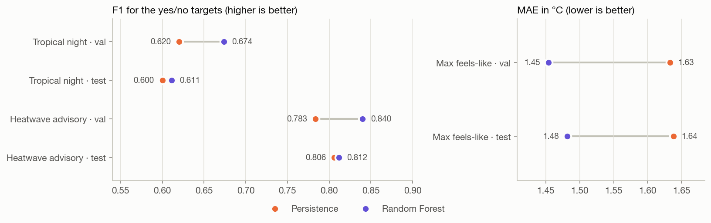

*How to read it:* each line connects the two models' scores. For F1 (left), right is better. For MAE (right), left is better.
Random Forest (violet) is ahead in every row, by a lot on val and on the temperature target, and only slightly on the
yes/no targets in the test.

#### Full tables

Yes/no targets ("-" = not defined for a yes/no rule):

| Target | Model | Split | Event days (%) | Precision | Recall | **F1** | PR-AUC | Brier |
|---|---|---|---|---|---|---|---|---|
| Tropical night | Persistence | val | 16.4 | 0.620 | 0.620 | 0.620 | - | 0.125 |
| Tropical night | Random Forest | val | 16.4 | 0.711 | 0.640 | **0.674** | 0.685 | 0.085 |
| Tropical night | Persistence | test | 19.7 | 0.600 | 0.600 | 0.600 | - | 0.158 |
| Tropical night | Random Forest | test | 19.7 | 0.688 | 0.550 | **0.611** | 0.755 | 0.084 |
| Heatwave advisory | Persistence | val | 15.1 | 0.745 | 0.826 | 0.784 | - | 0.069 |
| Heatwave advisory | Random Forest | val | 15.1 | 0.778 | 0.913 | **0.840** | 0.909 | 0.043 |
| Heatwave advisory | Persistence | test | 21.4 | 0.783 | 0.831 | 0.806 | - | 0.086 |
| Heatwave advisory | Random Forest | test | 21.4 | 0.767 | 0.862 | **0.812** | 0.815 | 0.070 |

Confusion matrices on the test summers (304 days):

| Target | Model | Caught (TP) | Missed (FN) | False alarm (FP) | Correctly quiet (TN) |
|---|---|---|---|---|---|
| Tropical night | Persistence | 36 | 24 | 24 | 220 |
| Tropical night | Random Forest | 33 | 27 | **15** | 229 |
| Heatwave advisory | Persistence | 54 | 11 | 15 | 224 |
| Heatwave advisory | Random Forest | **56** | **9** | 17 | 222 |

Max feels-like temperature (°C):

| Model | Split | **MAE** | RMSE | Bias |
|---|---|---|---|---|
| Persistence | val | 1.633 | 2.158 | -0.05 |
| Random Forest | val | **1.454** | 1.850 | -0.19 |
| Persistence | test | 1.638 | 2.210 | -0.03 |
| Random Forest | test | **1.482** | 1.961 | -0.15 |

#### Illustration 1: the confusion matrix as 304 test days

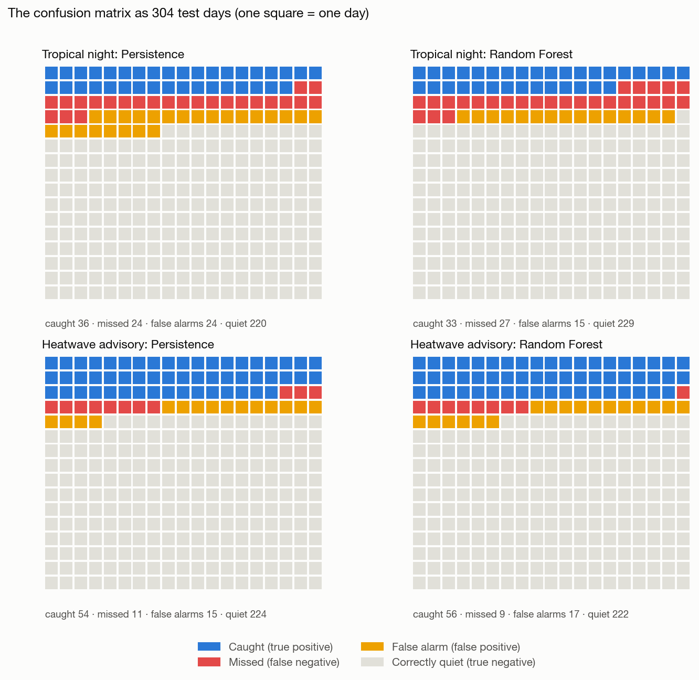

*How to read it:* every square is one test day, coloured by its confusion-matrix box. The grey squares are the
quiet days, which make up most of the summer, and this is why accuracy would look great even for a useless model.
The interesting part is the coloured top. For tropical nights, the forest swaps 9 false alarms (yellow) for 3 more
misses (red). For advisories, it catches 2 more events with 2 more false alarms.

#### Illustration 2: the test summers, day by day

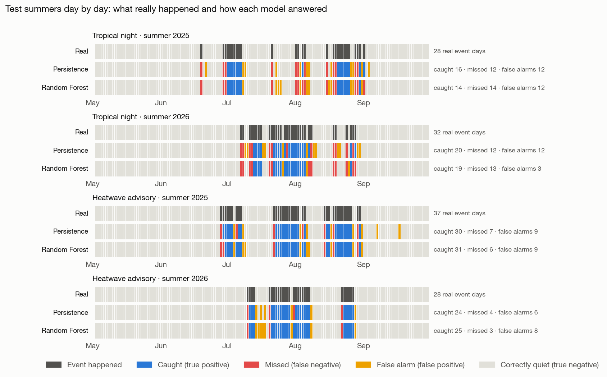

*How to read it:* each thin cell is one day, from May to September. The dark "Real" row shows when events really happened.
The rows below show how each model answered on that day. Three things stand out:

1. **Misses (red) sit at the start of each event.** For the advisory, **all 11** of persistence's misses and **8 of 9** of
   the forest's misses are the **first day** of a hot spell. Nothing in today's weather clearly says "a hot spell starts tomorrow".
2. **False alarms (yellow) sit right after each event.** For the advisory, 11 of persistence's 15 and 11 of the forest's 17 false
   alarms are the **day after a hot spell ended**: both models expect the heat to continue.
3. **Tropical nights, summer 2026:** the forest raised only **3 false alarms vs 12** for persistence while catching almost
   as many nights (19 vs 20). In summer 2025 it missed more (14 vs 12), which explains the near tie over the two summers.

#### Illustration 3: the temperature forecast

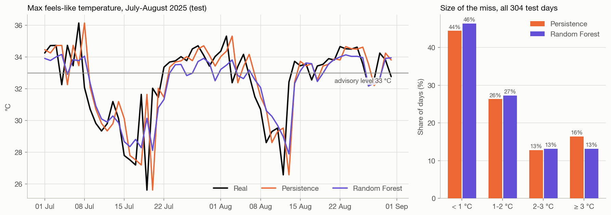

*How to read it (left):* the black line is reality. Persistence (orange) is the black line **shifted one day to the right**:
it is always one day late, which is why it misses every sudden change. The forest (violet) is smoother. It reacts sooner to
cool-downs, but it cuts off the highest peaks (it never predicted above 34.8 °C in the test).
*Right:* the forest has more small misses (< 1 °C: 46% vs 44% of days) and fewer big misses (≥ 3 °C: 13% vs 16%).

#### Which clues mattered most?

> **Explained: permutation importance**
> - **What:** shuffle one clue's column (destroying its information) and measure how much the score drops.
>   A big drop means the model relied on that clue.
> - **Why:** it shows *what the model learned*, so we can check it makes physical sense.
> - **Caution:** related clues (e.g. `feels_like_mean`, `feels_like_max` and their lags) can stand in for each other,
>   so they share importance. A small value does not always mean a clue is useless.

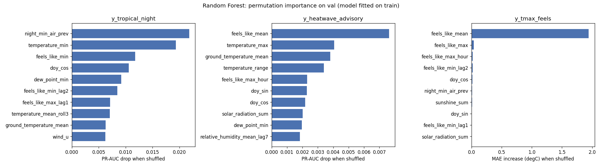

- **Tropical night:** last night's minimum (`night_min_air_prev`), today's minimum temperature and feels-like, the season
  (`doy_cos`) and the minimum dew point (humidity). This makes physical sense: warm, humid evenings lead to warm nights.
- **Heatwave advisory:** today's mean feels-like temperature, maximum air temperature, ground temperature and the daily
  temperature range.
- **Max feels-like:** today's mean feels-like temperature dominates (shuffling it worsens MAE by 1.9 °C).

### What the results mean

- **Max feels-like temperature:** a clear, consistent win for the Random Forest (about 10% smaller misses on both val and test).
  It predicts slightly too low on average (bias -0.15 to -0.19 °C), consistent with the hotter recent summers and the forest's
  inability to go beyond the values it has seen.
- **Heatwave advisory:** a clear win on val (F1 0.84 vs 0.78), about equal on test (0.81 vs 0.81). Persistence is very hard to
  beat, because a hot spell, once started, usually continues.
- **Tropical night:** better on val (F1 0.67 vs 0.62), about equal on test (0.61 vs 0.60). The forest gives far fewer false alarms,
  but it misses more nights. The threshold of 0.55 chosen on val was probably too strict for the hotter test summers
  (19.7% tropical nights vs 16.4% on val).
- **Probabilities:** the forest's probabilities are much more informative than persistence's yes/no
  (lower Brier score on every split, e.g. 0.084 vs 0.158 for tropical nights on test).
- **Honesty rule kept:** nothing was changed after seeing the test results.

> **Key message, Stage 4:** we compared a one-line rule with a 500-tree Random Forest, chose all settings without touching the test
> summers, and scored both once on 2025-2026. The forest is clearly better for the temperature forecast and gives better
> probabilities, but for yes/no warnings it only slightly beats "tomorrow will be like today". Both models struggle most
> with the first day of a hot spell.
>
> **Suggested slides:** (1) baseline idea + persistence rules; (2) decision tree → Random Forest (diagrams + Gini example);
> (3) how the splits are used; (4) threshold figure; (5) confusion matrix + precision/recall/F1 explained;
> (6) scoreboard; (7) waffle + season strip; (8) temperature figure; (9) feature importance.

---

## Stage 5: Conclusions

### What we achieved

1. Built a complete, **reproducible pipeline** from the KMA API to a trained model (5 scripts, each with a text report).
2. Implemented KMA's **official feels-like formula** and warning rules on 13 summers of station data.
3. Built a **leakage-free** daily table: every clue is known by 23:00 on day D, and every answer belongs to day D+1.
4. Compared a machine-learning model against a strong baseline with an **honest protocol**: settings chosen inside train,
   threshold chosen on val, test used once.

### Answer to our question

*Can we predict tomorrow's heat in Daegu from today's weather?*
**Yes, partly.** The temperature forecast is useful (average miss about 1.5 °C) and the Random Forest improves on the simple rule
by about 10%. For yes/no warnings, today's weather alone gives F1 scores of about 0.6 (tropical night) and 0.8 (advisory).
That is good, but only slightly better than assuming tomorrow will be like today. The hard part is the **onset** of a hot spell,
which needs information about tomorrow's weather that today's station readings do not contain.

### Lessons learned

- **Always start with a baseline.** Without persistence, an F1 of 0.81 would look impressive. With it, we know the honest improvement is small.
- **Accuracy is misleading for rare events.** "Always no" would be about 84% accurate.
- **Split by time, not randomly**, and use the test set once. Otherwise the scores are too optimistic.
- **Recent summers are hotter.** The data drifts, so a threshold chosen on older years may not fit newer years.

### Limitations

- Heatwave labels are runs of days, so tomorrow's label also depends on the day after tomorrow (part of KMA's definition).
- We use hourly data. KMA's official maxima and minima use 10-minute data, so our peaks can be slightly lower.
- Feels-like temperature is computed by us, not downloaded from KMA.
- The test set is small (2 summers, 304 days), so the test numbers are noisy.
- One station only (Daegu, station 143).

### Future work

- **Add forecast information:** numerical weather forecasts for tomorrow (or ERA5 variables such as cloud cover) could help
  predict the start of a hot spell.
- **Adapt the threshold** for warmer years (e.g. re-choose it each year on the most recent summers).
- **Try gradient boosting** (XGBoost or LightGBM) as a challenger, and add more stations around Daegu.
- **Predict the alarm levels** once more years with ≥ 35 °C events are available.

---

## How to reproduce

```bash
pip install requests pandas numpy scikit-learn matplotlib    # scikit-learn >= 1.4
export KMA_API_KEY="your_key"                                # needed only for the download
python A_ASOS_01_fetch_daegu_asos.py                         # Stage 1: download
python A_ASOS_02_clean_asos.py                               # Stage 2: clean
python A_ASOS_02_clean_asos_after_report.py                  #          drop incomplete columns
python A_ASOS_03_make_features.py                            # Stage 3: daily features and targets
python A_ASOS_03_make_features_after_report.py               #          drop the alarm targets
python A_ASOS_04_modeling.py                                 # Stage 4: persistence vs Random Forest
python A_ASOS_05_report_figures.py                           # Stage 5: figures for this report
```

All random steps use a fixed seed (42), so the results are identical on every run.

---

## Glossary

| Term | Plain-language meaning |
|---|---|
| ASOS | KMA's official automatic weather stations; our data source |
| API | a web address a program can ask for data |
| Baseline | the simplest reasonable prediction, used as the bar to beat |
| Bootstrap sample | a random draw of training days with replacement (some twice, some never) |
| Brier score | how close predicted probabilities are to what happened (lower is better) |
| Class weight | making rare yes-days count more during training |
| Confusion matrix | the four boxes: caught, missed, false alarm, correctly quiet |
| Data leakage | accidentally using future information as a clue; makes results look falsely good |
| Decision threshold | the probability above which the model says "yes" |
| Decision tree | a flowchart of yes/no questions learned from data |
| Expanding window | practice exams that always predict a later year than the ones studied |
| F1 score | a balance of precision and recall (0 to 1) |
| Feature (clue) | an input the model may use, known by 23:00 on day D |
| Feels-like temperature | how hot it feels to the body, combining air temperature and humidity (KMA formula) |
| Gini impurity | how mixed a group of yes/no days is (0 = pure) |
| Interpolation | filling a short gap by drawing a straight line between known values |
| Lag | the value of a variable k days ago |
| MAE | the average size of a miss, in °C |
| NaN | a marker for a missing value |
| Overfitting | memorising the training data instead of learning general patterns |
| Permutation importance | how much the score drops when one clue is shuffled |
| Persistence | the forecast "tomorrow will be like today" |
| PR-AUC | how well the probabilities rank real event days at the top (0 to 1) |
| Precision | of the warnings given, the share that were right |
| Random Forest | an average of many different decision trees |
| Recall | of the real events, the share that were caught |
| Reanalysis (ERA5) | model-made, gap-free weather estimates on a global grid |
| RMSE | like MAE, but big misses count extra |
| Rolling mean | the average of the last few days |
| Target (answer) | what the model must predict, here for day D+1 |
| Train / val / test | study data / practice exams / the final exam (split by years) |
| Tropical night | night minimum air temperature ≥ 25 °C |
| Wet-bulb temperature | the temperature of a wet thermometer; shows how well sweat can cool the body |
